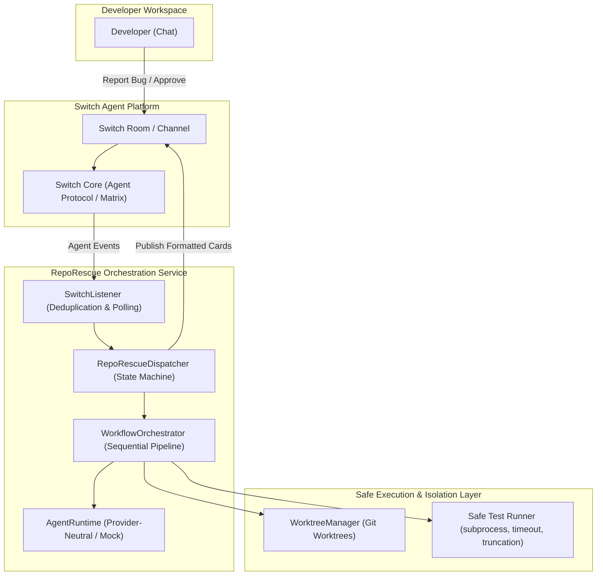
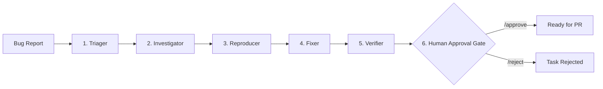

# RepoRescue Architecture

RepoRescue is an autonomous multi-agent engineering workflow designed for collaborative bug fixing inside Switch rooms. Developers report issues in chat; RepoRescue triages, investigates, reproduces, patches, verifies, and requests human approval.

---

## 1. System Architecture

---

## 2. Multi-Agent Pipeline

RepoRescue sequences specialized autonomous stages. Each stage consumes structured context from previous stages and returns validated typed output with genuine execution evidence.

### Stage Responsibilities & Artifacts

| Stage | Input | Agent Action | Primary Evidence / Output |
| :--- | :--- | :--- | :--- |
| **Triager** | Raw bug report, repository context | Classifies severity, defines acceptance criteria, identifies components | `TriageResult` (severity, acceptance criteria) |
| **Investigator** | Bug report, triage summary, codebase files | Inspects code paths, diagnoses root cause, defines reproduction strategy | `InvestigationResult` (root cause, affected files, evidence) |
| **Reproducer** | Investigation, isolated worktree | Generates minimal reproducer test file (`test_reproduce_*.py`), runs pytest | `ReproductionResult` (failing test exit code 1, test output) |
| **Fixer** | Root cause, reproduction test, worktree branch | Implements minimal surgical fix in isolated branch, runs `git diff` | `FixResult` (patch diff, files changed, rationale) |
| **Verifier** | Patched worktree, full test suite | Executes pytest via safe test runner, validates 0 failures | `VerificationResult` (passed count, failed count, exit code 0) |
| **Approval Gate**| Verification evidence, diff card | Pauses in `AWAITING_APPROVAL`. Enforces verified human identity | `TaskStatus.RESOLVED` or `TaskStatus.REJECTED` |

---

## 3. Worktree Isolation Invariants

All automated code modifications and reproducer tests are strictly segregated from the developer's main branch:

1. **Pristine Main Working Tree**: RepoRescue never creates branches or modifies files in the repository's root working tree.
2. **Dedicated Worktree Directory**: All worktrees reside within `.reporescue/worktrees/` (or a configured directory).
3. **Repository Exclusion**: RepoRescue automatically registers `.reporescue/` in `.git/info/exclude` to guarantee `git status` on the main tree remains clean.
4. **Destructive Operation Protection**: Worktrees with uncommitted changes cannot be removed without explicit `force=True` confirmation.
5. **Path Boundary Validation**: Worktree paths must strictly resolve inside `worktrees_dir` and are prevented from targeting root or parent directories.

---

## 4. Safe Command Execution Engine (`runner.py`)

Execution of pytest and Git commands is protected by deterministic safety boundaries:

- **No Shell Execution**: All commands are invoked directly as argument vectors (`shell=False`) to eliminate shell injection vulnerabilities.
- **Configurable Timeouts**: Every subprocess execution enforces a timeout (default: 30.0 seconds).
- **Output Buffering & Truncation**: Standard output and error streams are captured and capped (default: 4000 characters) to prevent memory exhaustion or oversized Switch messages.
- **Timing & Exit Code Tracking**: Exact duration (seconds) and integer exit codes are recorded as immutable workflow evidence.

---

## 5. Switch Integration & Human-in-the-Loop Gate

Switch serves as the central communication surface between human developers and RepoRescue:

- **Official Protocol Compatibility**: Ingests `SwitchMessageEvent` structures compatible with Switch Core 0.31.0 Agent Protocol.
- **Event Deduplication**: Inbound message IDs are tracked in an LRU deduplication cache to prevent re-processing events across network retries.
- **Exponential Reconnection**: Network disconnects trigger progressive backoff up to 30 seconds before reconnecting.
- **Anti-Bot Approval Verification**:
  - Approvals (`/approve`) from senders with `sender_kind == "agent"`, `sender_kind == "bot"`, or bot-like identifiers are rejected.
  - Only verified human senders can advance a task past `AWAITING_APPROVAL`.
  - The approver's handle and an ISO UTC timestamp are immutably stored in the task record.
- **Zero Auto-Merge / Auto-Deploy**: RepoRescue halts upon verification and human approval. Pull request creation, merging, and deployment remain exclusively under human control.
