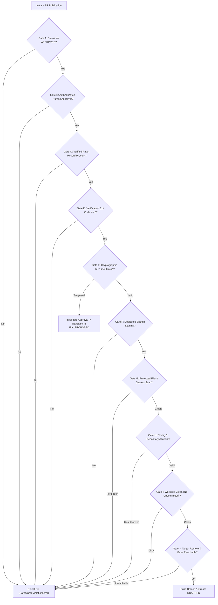

# RepoRescue: Secure GitHub Draft Pull Request Integration

This document outlines the architecture, security invariants, configuration, and verification protocols governing RepoRescue's GitHub Draft Pull Request integration (Milestone 5).

---

## 1. Architectural Overview & Security Invariants

RepoRescue operates as an autonomous engineering teammate inside Switch rooms. When an issue is reported, RepoRescue triages, investigates, reproduces the failure in an isolated Git worktree, generates a minimal fix, and runs an independent pytest verification suite.

**The Golden Safety Invariants:**
1. **DRAFT-Only PRs**: Every Pull Request created by RepoRescue is strictly marked `draft: True`. RepoRescue never creates ready-for-review or automatically mergeable pull requests.
2. **Zero Auto-Merge / Zero Auto-Deploy**: RepoRescue contains no code, credentials, or API calls to merge pull requests, push to protected branches (`main`/`master`), or trigger deployments. Human maintainers retain 100% governance.
3. **Cryptographically Bound Human Approval**: Every Pull Request requires prior sign-off from an authenticated human teammate. The approval is cryptographically bound to an exact SHA-256 fingerprint of the verified patch. Any post-approval file modification invalidates the approval and blocks publication.
4. **Isolated Worktrees & Dedicated Branches**: All changes are committed exclusively inside an isolated worktree on a dedicated branch named `reporescue/task-<task-id>`. The primary working tree is never touched.
5. **No Force Pushes**: RepoRescue pushes branches using standard `git push -u origin <branch>` without `--force`, preventing overwriting of remote history.
6. **Credential Privacy**: Secret tokens, bearer keys, and environment passwords are never stored, logged, posted to Switch rooms, or included in PR descriptions or Git commit messages.

---

## 2. GitHub Token Configuration & Required Permissions

RepoRescue communicates with GitHub using the official GitHub REST API v3 via Python's standard library (`urllib.request`), requiring zero external dependencies.

### Fine-Grained Personal Access Tokens (Recommended)
When creating a Fine-Grained Personal Access Token in **GitHub Settings -> Developer Settings -> Personal Access Tokens -> Fine-grained tokens**:

| Resource | Required Permission | Justification |
| :--- | :--- | :--- |
| **Repository Access** | *Only select repositories* | Principle of least privilege. Confinement to targeted repositories. |
| **Pull Requests** | **Read and write** | Required to check for existing PRs and call `POST /repos/{owner}/{repo}/pulls`. |
| **Contents** | **Read and write** | Required to push the dedicated branch `reporescue/task-<task-id>` to remote. |
| **Metadata** | **Read-only** | Automatically included by GitHub for repository discovery. |

> [!WARNING]
> Do NOT grant `Administration`, `Workflows`, `Secrets`, or `Branch Protection` permissions to RepoRescue.

### Classic Personal Access Tokens (Alternative)
If using classic PATs:
- Scope: `repo` (Full control of private repositories) or `public_repo` (for open source repositories).

---

## 3. Environment Variables Reference

Configure the following environment variables in `.env` (never committed to Git):

| Variable | Required | Default | Description |
| :--- | :--- | :--- | :--- |
| `GITHUB_TOKEN` | Yes (in live mode) | *None* | GitHub Personal Access Token (or `GH_TOKEN`). |
| `GITHUB_REPOSITORY` | Recommended | Auto-detected from `git remote origin` | Target repository in `owner/repo` format (e.g., `switch-hackathon/RepoRescue`). |
| `GITHUB_BASE_BRANCH` | Optional | `main` | Base branch to target for the pull request. |
| `GITHUB_API_URL` | Optional | `https://api.github.com` | GitHub API root URL (supports GitHub Enterprise Server). |
| `GITHUB_REPO_ALLOWLIST` | Optional | *Empty* | Comma-separated list of permitted repositories (e.g. `org/repo1,org/repo2`). |
| `GITHUB_DRY_RUN` | Optional | `false` | When set to `1` or `true`, simulates branch push and mock PR generation without calling GitHub. |

---

## 4. The 10 Strict Safety Gates (A through J)

Before any Git push or PR creation is initiated, `GitHubPRManager.validate_safety_gates()` evaluates the following 10 mandatory gates:



### Detailed Safety Gate Definitions

- **Gate A — Task Status Gate**: The task status must strictly be `TaskStatus.APPROVED`. Unapproved tasks or tasks in progress cannot trigger PR creation.
- **Gate B — Human Approval Gate**: The approver identity recorded on the task must exist and cannot match automated bot prefixes (`bot:`, `agent:`, `system:`, `@switch-agent-`) or bot usernames.
- **Gate C — Verified Patch Record Gate**: The task must contain an immutable record of verification (`verified_patch_fingerprint` or verification evidence).
- **Gate D — Verification Success Gate**: The independent verification test suite must have completed with exit code `0` (zero failures).
- **Gate E — Cryptographic Patch Tamper Detection Gate**: The current worktree git diff is re-hashed. If the computed SHA-256 fingerprint differs from `task.approved_patch_fingerprint`, **Gate E immediately invalidates the approval**:
  - Resets `approval_by`, `approved_at`, and `approved_patch_fingerprint`.
  - Transitions the task status back to `fix_proposed`.
  - Logs the tamper incident and appends evidence.
  - Re-verification and fresh human approval are mandatory before proceeding.
- **Gate F — Worktree & Branch Confinement Gate**: The active worktree branch must strictly follow `reporescue/task-<task-id>` format and match the task's assigned proposed branch. RepoRescue refuses to push to `main`, `master`, `develop`, or any unmanaged branch.
- **Gate G — File Boundaries & Secret Leakage Gate**:
  - No modified files may target protected paths: `.git/`, `.reporescue/`, `.venv/`, `.pytest_cache/`, `.ruff_cache/`, `.env`, `.env.local`.
  - Scans diff and commit messages against regex patterns for API tokens (`ghp_`, `github_pat_`, Slack tokens, private keys).
- **Gate H — Target Repository Allowlist Gate**: Target repository format must match `owner/repo`. If `GITHUB_REPO_ALLOWLIST` is configured, the target repository must be explicitly listed.
- **Gate I — Clean Working Tree Gate**: The worktree must contain no untracked, uncommitted, or unstaged file modifications before branch pushing.
- **Gate J — Remote Repository & Base Branch Gate**: Validates that the target repository and base branch exist and are reachable before attempting push.

---

## 5. Cryptographic Patch Fingerprinting

To ensure that the human approves *the exact code that was tested and that will be published*, RepoRescue calculates a normalized SHA-256 hash of the git diff:

```python
fingerprint = "sha256:" + hashlib.sha256(normalized_diff.encode("utf-8")).hexdigest()
```

### Line-Ending & Whitespace Invariance
Differences between Windows (CRLF) and Linux/macOS (LF) line endings, as well as trailing whitespace introduced by different editors, are normalized before hashing:
- All `\r\n` and `\r` are converted to `\n`.
- Trailing whitespace on each line is stripped.
- Trailing empty lines are trimmed.

This guarantees cross-platform deterministic verification whether the developer approves on Windows or Linux.

---

## 6. Structure of the GitHub Draft Pull Request

Every pull request created by RepoRescue is structured with 8 standardized Markdown sections for complete auditability:

```markdown
## Summary
Concise overview of the bug and the verified surgical resolution.

## Problem & Root Cause Analysis
- Detailed diagnosis from Investigator Agent.
- Identified faulty components and files.

## Reproduction Proof
- Minimal reproduction test file (`tests/test_reproduce_*.py`).
- Initial exit code (`1`) and captured traceback demonstrating reproduction.

## Proposed Fix & Surgical Rationale
- Rationale from Fixer Agent.
- List of modified files and git diff overview.

## Independent Verification Evidence
- Verification framework (`pytest` in isolated worktree).
- Exit code (`0`), passed count, duration, and test output.

## Human Approval Record
- Approver: `@username` (verified human teammate).
- Timestamp: ISO 8601 UTC timestamp.
- Patch Fingerprint: `sha256:...`.

## Safety Invariants & Governance Policy
- Explicit notice that PR is strictly in **DRAFT** state.
- Zero auto-merge confirmation.

## Files Changed
- Formatted list of all touched files.
```

---

## 7. Switch Room Integration & Commands

Developers interact with RepoRescue directly inside Switch rooms:

### 1. Automatic PR Creation on `/approve`
When a human replies `/approve`:
1. Dispatcher validates human identity and compares patch fingerprint.
2. Transitions task to `approved`.
3. If GitHub is configured, automatically executes the PR creation pipeline.
4. Posts the **Draft PR Created** card with clickable links to the Switch room.

### 2. Manual PR Trigger (`/publish-pr` or `/create-pr`)
If GitHub was not configured at the time of approval, or if network issues prevented initial creation, any authorized human can re-trigger publication:
```text
/publish-pr [optional-task-id]
```

### 3. Rejection (`/reject <reason>`)
If the human maintainer is not satisfied with the fix or reproduction test:
```text
/reject Needs edge case handling for empty strings
```
Transitions task to `rejected`. No branch is pushed, and no PR is created.

---

## 8. Diagnostic CLI Command (`--github-check`)

To inspect and validate your GitHub setup prior to running live sessions:

```powershell
python -m reporescue.cli --github-check
```

**Diagnostic Output Sample:**
```text
======================================================================
  REPORESCUE: GITHUB INTEGRATION DIAGNOSTIC CHECK
======================================================================

Target Repository:    switch-hackathon/RepoRescue
Base Branch:          main
API Endpoint:         https://api.github.com
Draft Enforcement:    True (Strictly enforced)
Dry Run Mode:         False
Repository Allowlist: switch-hackathon/RepoRescue
Token Configuration:  ghp_...3456

[Validating Authentication & Repository Access with GitHub API...]
  ✓ Connected to repository: switch-hackathon/RepoRescue
  ✓ Default branch: main
  ✓ Permissions: push=True, pull=True

Readiness: ✅ READY for secure Draft PR publishing.
```

---

## 9. Offline Simulation & Safe Retries

- **Offline / Deterministic Demos**: When running with `--mock --demo` or `GITHUB_DRY_RUN=1`, `MockGitHubClient` intercepts all network requests. It validates safety gates, generates deterministic PR numbers and URLs, and formats the Switch cards without making network calls.
- **Idempotency**: If a PR already exists for the head branch (e.g. from a previous run), RepoRescue detects the open PR, updates metadata, and returns the existing PR URL rather than crashing or creating duplicates.
